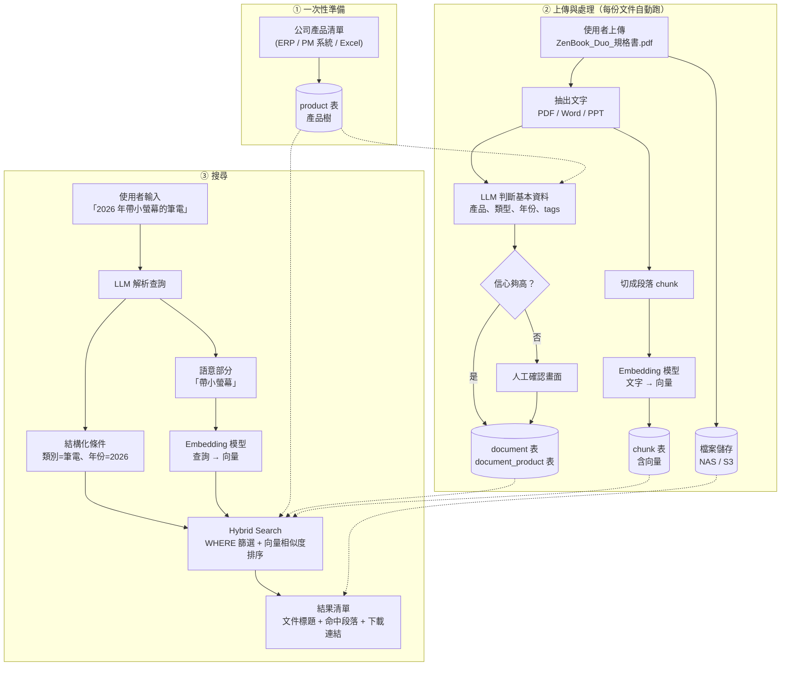
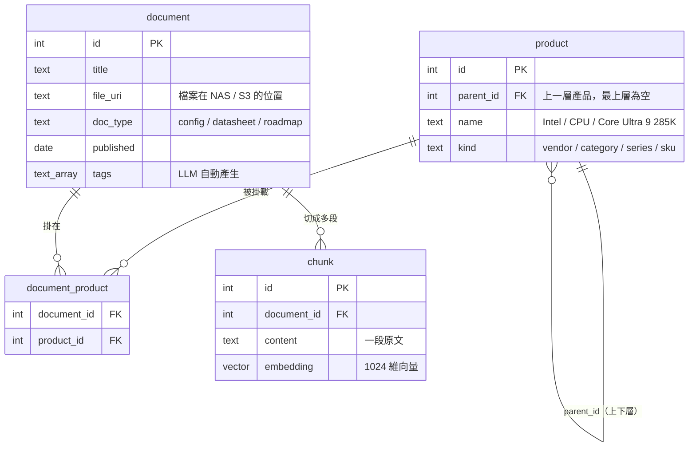
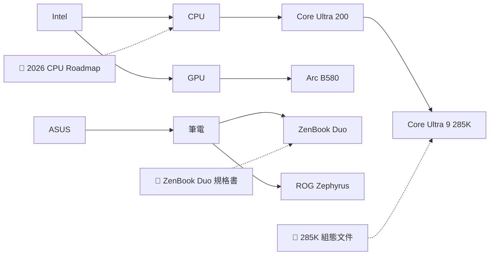
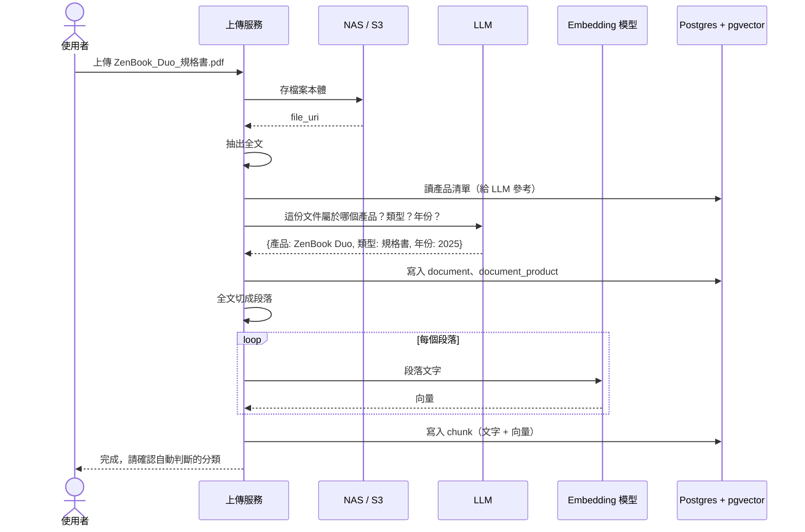
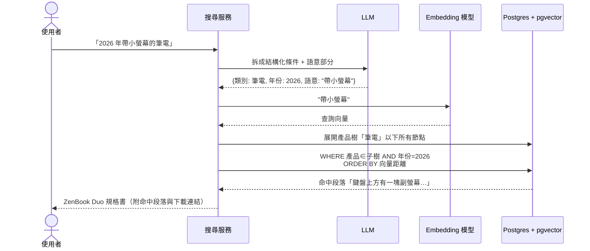
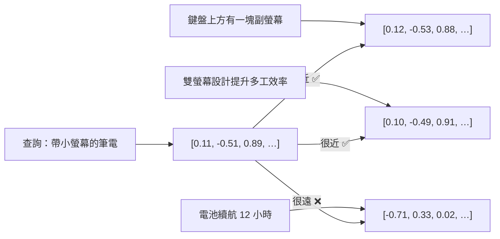
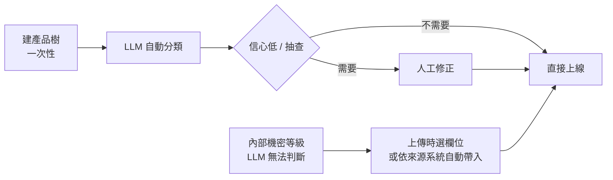

# 產品文件搜尋系統設計

> 目標：使用者可以用一句話搜尋公司的產品文件，例如
> - 「2026 年 CPU 發展」→ 依類別、年份篩選
> - 「Core Ultra 200 的組態文件」→ 依產品樹篩選
> - 「帶小螢幕的筆電」→ 依語意找到「雙螢幕筆電」的資料

[TOC]

---

## 一、全貌：從上傳到搜尋



| 階段 | 頻率 | 要人工嗎 |
|---|---|---|
| ① 建產品樹 | 一次性，新產品上市時補 | 要，但只是匯入現有清單 |
| ② 上傳處理 | 每份文件 | 不用，LLM 信心低時才需要人看 |
| ③ 搜尋 | 每次查詢 | 不用 |

---

## 二、資料結構



- **檔案本體不進資料庫**，資料庫只記 `file_uri`。
- **一份文件可以掛多個產品**（`document_product` 多對多），所以不用資料夾分類。
- **產品樹只記上一層**（`parent_id`），查詢時沿著樹往下展開，不需要在文件上重複貼「Intel」「CPU」。

### 產品樹範例



---

## 三、上傳處理：一份文件的流程



> 把產品清單交給 LLM，讓它從清單裡挑選，而不是自由發揮，這樣產品名稱才會一致（不會出現「ZenBook Duo」和「Zenbook DUO」兩種寫法）。

---

## 四、搜尋：一次查詢的流程



### 為什麼「小螢幕」找得到「雙螢幕」？



Embedding 模型把「意思」轉成數字，意思相近的句子數字也相近。**沒有人貼過「雙螢幕」標籤**，靠模型本身理解。

---

## 五、三種查詢對應的 SQL

### 1. 某產品底下的組態文件（產品樹）

```sql
WITH RECURSIVE sub AS (
  SELECT id FROM product WHERE name = 'Core Ultra 200'
  UNION ALL
  SELECT p.id FROM product p JOIN sub ON p.parent_id = sub.id
)
SELECT DISTINCT d.*
FROM document d
JOIN document_product dp ON dp.document_id = d.id
WHERE dp.product_id IN (SELECT id FROM sub)
  AND d.doc_type = 'config';
```

### 2. 2026 年 CPU 發展（產品樹 + 年份 + 類型）

```sql
WITH RECURSIVE sub AS (
  SELECT id FROM product WHERE name = 'CPU'
  UNION ALL
  SELECT p.id FROM product p JOIN sub ON p.parent_id = sub.id
)
SELECT DISTINCT d.*
FROM document d
JOIN document_product dp ON dp.document_id = d.id
WHERE dp.product_id IN (SELECT id FROM sub)
  AND d.published BETWEEN '2026-01-01' AND '2026-12-31'
  AND d.doc_type IN ('roadmap', 'whitepaper');
```

### 3. 帶小螢幕的筆電（語意搜尋，可再疊加篩選）

```sql
SELECT d.title, c.content, c.embedding <=> :query_vec AS distance
FROM chunk c
JOIN document d ON d.id = c.document_id
ORDER BY c.embedding <=> :query_vec
LIMIT 20;
```

---

## 六、技術選型

| 元件 | 建議 | 何時升級 |
|---|---|---|
| 檔案儲存 | 現有 NAS 或 S3 / MinIO | — |
| 資料庫 | Postgres + pgvector（一套搞定） | chunk 破千萬筆再考慮專用向量資料庫 |
| 文字抽取 | PDF / Office 解析套件 | 掃描檔需要加 OCR |
| LLM | 分類與查詢解析 | — |
| Embedding | 支援中文的多語模型 | — |
| 產品關係 | `parent_id` 一層層往上記 | 需要「競品」「相容於」時加 `product_relation` 表 |

## 七、人工介入點


